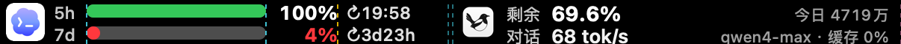

# QuotaStrip

[English](README.md)

QuotaStrip 把 MacBook Pro 的 Touch Bar 变成 Codex 和 AI 用量的小型实时仪表盘。
这是一个面向 Codex 桌面端和本地 [Magpie](https://github.com/yetone/magpie) 网关的个人分支，
基于 [hohocf/QuotaStrip](https://github.com/hohocf/QuotaStrip) 继续开发。



Touch Bar 上显示：

- Codex 的 5 小时、7 天**剩余额度**。
- Token Plan 剩余百分比、今日 Token、当前模型、缓存命中率和输出速度。
- Magpie 能提供有效额度桶时，显示可选的 Kimi Code 余额行。
- 右侧系统 Control Strip。

菜单栏面板提供更完整的统计：DeepSeek 余额、Token Plan Credits、Magpie 各供应商和模型消耗、
Kimi Code 额度，以及完整的 Magpie 用量热力图。鼠标扫过热力图日期方块时，会在方块附近显示
当天日期、星期和 Token 数量。

## 安装前

- 一台带物理 Touch Bar 的 MacBook Pro。
- macOS 11 或更高版本；开机自启需要 macOS 13 或更高版本。
- 实时 Codex 额度需要位于 `/Applications/ChatGPT.app` 的 ChatGPT/Codex 桌面端；
  读取失败时还会回退到 Codex app-server 和 `~/.codex/sessions`。
- Magpie 为可选依赖。未运行 Magpie 时，Codex 仍有回退数据源，Magpie 专属卡片会显示暂无数据。

应用通过私有 `DFRFoundation` API 控制 Touch Bar，原理与 MTMR、Pock 相同。它不是 Mac App Store
应用，也没有经过 Apple 公证。

## 安装

1. 从 [Releases](https://github.com/JasonBeam/quotastrip-magpie/releases) 下载
   `QuotaStrip.zip` 和 `SHA256SUMS.txt`。
2. 校验压缩包：

   ```bash
   shasum -a 256 QuotaStrip.zip
   ```

3. 解压后把 `QuotaStrip.app` 拖入 `/Applications`。
4. 退出旧版 QuotaStrip，首次启动时按住 Control 点击应用并选择“打开”，以接受未公证签名。
5. 如果 Touch Bar 正被其他应用占用，点击菜单栏 QuotaStrip 图标，选择“重新显示 Touch Bar”。

不需要辅助功能权限，不安装 Claude hooks，不修改 Codex 配置，也不会安装 LaunchAgent。
你可以在 QuotaStrip 菜单里按需将它设为登录项。

## 从源码构建

```bash
git clone https://github.com/JasonBeam/quotastrip-magpie.git
cd quotastrip-magpie
./build.sh
```

构建需要 Xcode 和命令行工具。完成后会在 `/tmp/QuotaStrip.app` 生成 Intel + Apple Silicon
通用应用。

## 数据来源

- **Codex 额度：** 优先读取 Magpie 本机只读接口；失败后回退 Codex app-server 的
  `account/rateLimits/read` 和 `~/.codex/sessions`。只使用 `codex` 额度桶。
- **Magpie 用量：** 读取 Magpie 本机接口及只读缓存/历史文件。
- **DeepSeek：** 仅在用户主动把 API Key 保存到 macOS 钥匙串后，查询官方余额接口。

界面每 20 秒刷新一次，请求串行执行并使用缓存，避免重叠刷新。缺少可靠数据时会显示“暂无数据”，
不会把未知值伪造成 100%。

## 使用行为

- Codex/ChatGPT 启动时显示 Touch Bar；完全退出时隐藏。
- Mac 唤醒后会重新检查 Codex/ChatGPT 是否运行。
- Touch Bar 隐藏时，菜单栏控制入口和 QuotaStrip 进程仍会保留。
- Codex 百分比代表剩余额度，不是已用额度。
- 剩余额度大于 50% 显示绿色，21%–50% 显示黄色，20% 及以下显示红色。

## 已知限制

- Touch Bar 使用私有 API，未来 macOS 更新可能改变行为。
- 发布包已签名但未经过 Apple 公证，首次启动需要手动确认。
- Magpie 专属卡片依赖 Magpie 本机服务可用。
- 数值取决于 Codex、Magpie 和各供应商接口；供应商修改接口后，对应行可能暂时显示暂无数据。
- 本版本已在维护者的 Touch Bar Mac 上实机验证，但下载者仍应确认自己的物理 Touch Bar 布局和账号数据。

## 隐私

QuotaStrip 只读取本机 Codex 会话数据和 Magpie 本机接口。它不会修改 `~/.codex/config.toml`，
不会注入记忆，不会安装 hooks，也不会上传对话内容。可选的供应商 Key 只保存在 macOS 钥匙串，
不会进入仓库或发布压缩包。

## 来源与许可证

本项目基于 [hohocf/QuotaStrip](https://github.com/hohocf/QuotaStrip)，沿用 MIT License。
产品名称和图标归各自权利人所有，仅用于标识数据来源。
